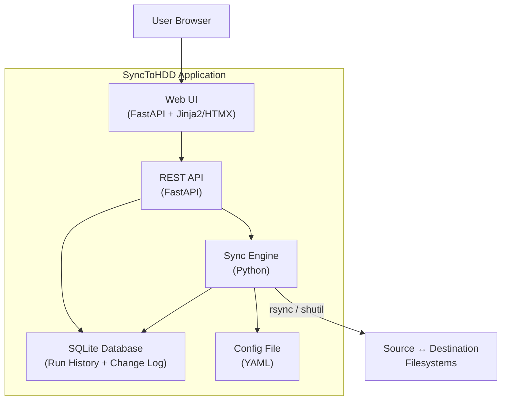
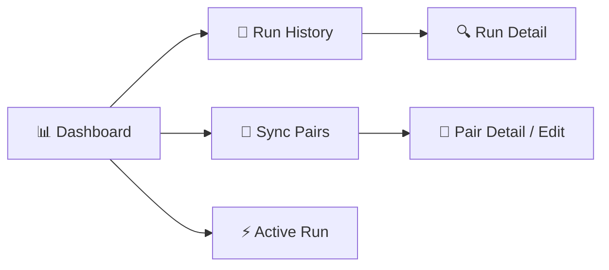
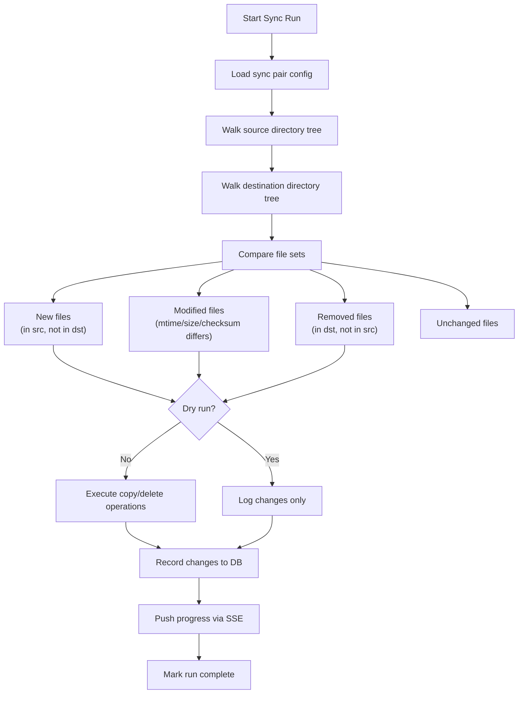

# SyncToHDD — Project Plan

> A Python-based file/folder sync tool with a Web UI, Docker support, and full run history — designed to back up a Linux server to an external USB3 HDD.

---

## 1. Problem Statement

Back up data from a Linux server to an external HDD connected via USB3. The solution must:

- Sync files & directories from **multiple source → destination pairs**
- Work on both **Linux and Windows**
- Provide a **Web UI** to monitor progress and review historical runs
- Be **Docker-compatible** for easy deployment
- Track **what changed** in each run (added, modified, deleted files)
- Run on a **local intranet** — no authentication required

---

## 2. Architecture Overview



### Component Breakdown

| Component | Technology | Purpose |
|-----------|-----------|---------|
| **Sync Engine** | Python (`shutil`, `rsync` wrapper, `hashlib`) | Core file comparison & copy logic |
| **REST API** | FastAPI | Exposes sync operations, status, and history |
| **Web UI** | Jinja2 templates + HTMX + vanilla JS | Browser-based dashboard |
| **Database** | SQLite (via SQLAlchemy) | Stores run history, change logs, config |
| **Config** | YAML file | Defines sync pairs, schedules, options |
| **Container** | Docker + docker-compose | Deployment & portability |

---

## 3. Core Features

### 3.1 Sync Engine

- **Incremental sync** — only copy new or modified files (compare by mtime + size, optionally by checksum)
- **Delete handling** — configurable: mirror (delete at dest if removed from src) or additive (never delete)
- **Dry-run mode** — preview changes without copying
- **Exclusion patterns** — glob/regex patterns to skip files or directories
- **Bandwidth throttling** — optional rate limiting for large transfers
- **Backend strategy**:
  - **Linux**: prefer `rsync` subprocess (fast, reliable, delta transfers)
  - **Windows / fallback**: pure-Python engine using `shutil` + `os.walk` + file hashing
  - Auto-detect which backend to use based on OS and `rsync` availability

### 3.2 Sync Pair Configuration

```yaml
# config.yaml
sync_pairs:
  - name: "Manga CBZ Backup"
    source: "/sg2b/Share2sgb/Manga/Manga_CBZ_1"
    destination: "/media/devmon/LX2T/BackupServer"
    mode: "mirror"            # mirror | additive
    exclude:
      - "*.tmp"
      - ".thumbs/"
    checksum: false           # use checksum comparison (slower but more accurate)
    bandwidth_limit: null     # e.g. "50M" for 50 MB/s cap

  - name: "Documents Backup"
    source: "/home/alex/Documents"
    destination: "/media/devmon/LX2T/BackupServer/Documents"
    mode: "additive"
    exclude:
      - "node_modules/"
      - "__pycache__/"

server:
  host: "0.0.0.0"
  port: 6060
  log_level: "info"

database:
  path: "./data/synctohdd.db"
```

### 3.3 Run History & Change Tracking

Every sync run is recorded with:

| Field | Description |
|-------|-------------|
| `run_id` | UUID |
| `sync_pair_name` | Which pair was synced |
| `started_at` | Timestamp |
| `finished_at` | Timestamp |
| `status` | `running` · `completed` · `failed` · `cancelled` |
| `files_added` | Count |
| `files_modified` | Count |
| `files_deleted` | Count |
| `files_unchanged` | Count |
| `bytes_transferred` | Total data moved |
| `error_log` | Any errors encountered |
| `dry_run` | Boolean |

Each **individual file change** is also logged:

| Field | Description |
|-------|-------------|
| `change_id` | Auto-increment |
| `run_id` | FK to run |
| `action` | `added` · `modified` · `deleted` · `unchanged` |
| `file_path` | Relative path |
| `file_size` | Bytes |
| `source_mtime` | Source modification time |

### 3.4 Web UI Pages



| Page | Description |
|------|-------------|
| **Dashboard** | Overview: last run per pair, disk usage, quick-start buttons |
| **Sync Pairs** | List all configured pairs, add/edit/remove, test connection |
| **Active Run** | Real-time progress bar, live file list, ETA, cancel button |
| **Run History** | Paginated table of all past runs with status badges and filters |
| **Run Detail** | Full change log for a specific run — added/modified/deleted files, sizes, errors |

**Real-time updates**: Use **Server-Sent Events (SSE)** to push progress to the browser without polling.

### 3.5 REST API Endpoints

```
GET    /api/health                    # Health check
GET    /api/pairs                     # List all sync pairs
POST   /api/pairs                     # Create a sync pair
PUT    /api/pairs/{name}              # Update a sync pair
DELETE /api/pairs/{name}              # Delete a sync pair

POST   /api/sync/{pair_name}          # Start a sync (body: {dry_run: bool})
POST   /api/sync/all                  # Start all pairs sequentially
DELETE /api/sync/active               # Cancel running sync
GET    /api/sync/status               # Current sync status + progress

GET    /api/runs                      # List runs (paginated, filterable)
GET    /api/runs/{run_id}             # Run detail + summary stats
GET    /api/runs/{run_id}/changes     # File-level change log (paginated)

GET    /api/events                    # SSE stream for live progress
```

---

## 4. Project Structure

```
SyncToHDD/
├── docker-compose.yml
├── Dockerfile
├── requirements.txt
├── config.yaml                  # User-editable sync configuration
├── README.md
├── PLAN.md                      # This file
│
├── synctohdd/                   # Main Python package
│   ├── __init__.py
│   ├── main.py                  # App entry point (uvicorn runner)
│   ├── config.py                # YAML config loader & validation (Pydantic)
│   │
│   ├── engine/                  # Sync engine
│   │   ├── __init__.py
│   │   ├── base.py              # Abstract sync backend
│   │   ├── rsync_backend.py     # rsync subprocess wrapper (Linux)
│   │   ├── python_backend.py    # Pure-Python fallback (Windows/cross-platform)
│   │   └── comparator.py        # File comparison logic (mtime, size, checksum)
│   │
│   ├── api/                     # FastAPI routes
│   │   ├── __init__.py
│   │   ├── app.py               # FastAPI app factory
│   │   ├── routes_pairs.py      # Sync pair CRUD
│   │   ├── routes_sync.py       # Sync trigger & status
│   │   ├── routes_runs.py       # Run history & details
│   │   └── routes_events.py     # SSE stream
│   │
│   ├── db/                      # Database layer
│   │   ├── __init__.py
│   │   ├── models.py            # SQLAlchemy ORM models
│   │   ├── database.py          # Engine & session setup
│   │   └── crud.py              # DB operations
│   │
│   ├── web/                     # Web UI
│   │   ├── templates/           # Jinja2 HTML templates
│   │   │   ├── base.html
│   │   │   ├── dashboard.html
│   │   │   ├── pairs.html
│   │   │   ├── pair_edit.html
│   │   │   ├── runs.html
│   │   │   ├── run_detail.html
│   │   │   └── active_run.html
│   │   └── static/              # CSS, JS, icons
│   │       ├── css/
│   │       │   └── style.css
│   │       ├── js/
│   │       │   └── app.js
│   │       └── favicon.ico
│   │
│   └── utils/                   # Shared utilities
│       ├── __init__.py
│       ├── logger.py            # Structured logging
│       └── platform.py          # OS detection & path normalization
│
├── data/                        # Runtime data (mounted volume in Docker)
│   └── synctohdd.db             # SQLite database (auto-created)
│
└── tests/                       # Test suite
    ├── __init__.py
    ├── test_engine.py
    ├── test_api.py
    └── test_comparator.py
```

---

## 5. Technology Choices & Justification

| Choice | Why |
|--------|-----|
| **Python 3.11+** | Cross-platform, rich stdlib (`shutil`, `os`, `subprocess`), fast enough for I/O-bound work |
| **FastAPI** | Async-first, auto-generates OpenAPI docs, native SSE support, excellent performance |
| **Jinja2 + HTMX** | Server-rendered UI with dynamic updates — no heavy JS framework needed, keeps the project simple |
| **SQLite** | Zero-config, single-file DB, perfect for a self-hosted backup tool; no external DB needed |
| **SQLAlchemy 2.0** | Robust ORM with async support, makes DB operations clean and testable |
| **Pydantic** | Config validation, API serialization — already included with FastAPI |
| **rsync** (Linux) | Gold standard for incremental file sync; delta transfers, permissions, symlinks |
| **shutil** (fallback) | Built-in Python; works everywhere without external dependencies |
| **Docker** | Reproducible deployment; mount source/dest volumes + persist DB |

---

## 6. Docker Setup

### Dockerfile

```dockerfile
FROM python:3.11-slim

RUN apt-get update && apt-get install -y rsync && rm -rf /var/lib/apt/lists/*

WORKDIR /app
COPY requirements.txt .
RUN pip install --no-cache-dir -r requirements.txt

COPY . .
EXPOSE 6060

CMD ["python", "-m", "synctohdd.main"]
```

### docker-compose.yml

```yaml
version: "3.8"
services:
  synctohdd:
    build: .
    container_name: synctohdd
    ports:
      - "6060:6060"
    volumes:
      - ./config.yaml:/app/config.yaml           # Config
      - ./data:/app/data                          # SQLite DB persistence
      - /sg2b:/sg2b:ro                            # Source (read-only)
      - /media/devmon/LX2T:/media/devmon/LX2T     # Destination (read-write)
    restart: unless-stopped
```

> **Note:** The source and destination paths must be mounted as Docker volumes so the container can access the host filesystem. Sources should be mounted **read-only** (`:ro`) for safety.

---

## 7. Sync Engine — Detailed Logic



### Comparison Strategy

1. **Fast path** (default): Compare `mtime` + `file_size` — handles 99% of cases correctly
2. **Checksum mode** (opt-in per pair): SHA-256 hash comparison — catches edge cases where mtime was reset but content changed
3. **File attributes preserved**: `shutil.copy2()` preserves metadata; `rsync -a` preserves permissions, timestamps, symlinks

---

## 8. Database Schema

### `sync_runs` Table

```sql
CREATE TABLE sync_runs (
    run_id          TEXT PRIMARY KEY,    -- UUID
    sync_pair_name  TEXT NOT NULL,
    started_at      DATETIME NOT NULL,
    finished_at     DATETIME,
    status          TEXT NOT NULL DEFAULT 'running',  -- running | completed | failed | cancelled
    files_added     INTEGER DEFAULT 0,
    files_modified  INTEGER DEFAULT 0,
    files_deleted   INTEGER DEFAULT 0,
    files_unchanged INTEGER DEFAULT 0,
    bytes_transferred INTEGER DEFAULT 0,
    error_log       TEXT,
    dry_run         BOOLEAN DEFAULT FALSE
);
```

### `file_changes` Table

```sql
CREATE TABLE file_changes (
    change_id    INTEGER PRIMARY KEY AUTOINCREMENT,
    run_id       TEXT NOT NULL REFERENCES sync_runs(run_id),
    action       TEXT NOT NULL,         -- added | modified | deleted | unchanged
    file_path    TEXT NOT NULL,
    file_size    INTEGER,
    source_mtime DATETIME
);

CREATE INDEX idx_file_changes_run_id ON file_changes(run_id);
CREATE INDEX idx_file_changes_action ON file_changes(action);
```

---

## 9. Implementation Phases

### Phase 1 — Core Engine & CLI *(MVP)*
- [ ] Config loader (YAML → Pydantic models)
- [ ] Pure-Python sync backend (`python_backend.py`)
- [ ] `rsync` backend wrapper (`rsync_backend.py`)
- [ ] Auto-detection of backend (OS + rsync availability)
- [ ] File comparator (mtime/size + optional checksum)
- [ ] SQLite models & CRUD for runs + changes
- [ ] CLI entry point: `python -m synctohdd.main sync [pair_name|all]`
- [ ] Structured logging

### Phase 2 — REST API
- [ ] FastAPI app setup with CORS
- [ ] Sync pair CRUD endpoints
- [ ] Sync trigger + cancellation endpoints
- [ ] Run history + detail endpoints
- [ ] SSE stream for live progress
- [ ] Health check endpoint

### Phase 3 — Web UI
- [ ] Base template with navigation (dark theme)
- [ ] Dashboard page (summary cards, quick actions)
- [ ] Sync pairs management page (list, add, edit, delete)
- [ ] Active run page (real-time progress via SSE)
- [ ] Run history page (paginated table with filters)
- [ ] Run detail page (file-level change log)

### Phase 4 — Docker & Deployment
- [ ] Dockerfile
- [ ] docker-compose.yml with volume mounts
- [ ] README with setup instructions
- [ ] Environment variable overrides for config
- [ ] Healthcheck in Docker

### Phase 5 — Polish & Extras *(Future)*
- [ ] Scheduled syncs (cron-like, via APScheduler)
- [ ] Email/webhook notifications on failure
- [ ] Disk space warnings before sync
- [ ] Bandwidth throttling
- [ ] Multi-threaded file copy for large batches

---

## 10. Key Design Decisions

| Decision | Rationale |
|----------|-----------|
| **No authentication** | Runs on local intranet only; no exposure to public internet |
| **Port 6060** | Unique port unlikely to conflict with other services |
| **SQLite over PostgreSQL** | Self-hosted single-user tool doesn't need a full RDBMS; SQLite is zero-config and file-based |
| **rsync + Python fallback** | rsync is battle-tested on Linux but unavailable on Windows by default; Python fallback ensures cross-platform |
| **HTMX over React/Vue** | Keeps the project lean — no build step, no node_modules, server-rendered with dynamic behavior |
| **SSE over WebSocket** | Simpler for one-way server→client updates (progress); no need for bidirectional comms |
| **YAML config** | Human-readable, widely understood, easy to version control alongside the project |
| **Single container** | App + SQLite in one container keeps deployment dead simple; no orchestration needed |

---

## 11. Dependencies (`requirements.txt`)

```
fastapi>=0.104.0
uvicorn[standard]>=0.24.0
sqlalchemy>=2.0.0
aiosqlite>=0.19.0
pydantic>=2.0.0
pydantic-settings>=2.0.0
pyyaml>=6.0
jinja2>=3.1.0
python-multipart>=0.0.6
sse-starlette>=1.6.0
humanize>=4.8.0
```

---

## 12. Risks & Mitigations

| Risk | Impact | Mitigation |
|------|--------|------------|
| External HDD disconnects mid-sync | Partial/corrupt copy | Detect mount point availability before starting; atomic copy pattern (write to `.tmp`, rename) |
| Very large source trees (millions of files) | Slow scan, high memory | Stream file listing, paginate DB inserts, use rsync (it handles this natively) |
| Docker can't access USB HDD | Sync fails | Document volume mount requirements; test with `--privileged` if needed |
| SQLite write contention | API slowness during sync | Use WAL mode, separate read/write sessions |
| rsync not available on host | Falls back silently | Log warning on startup, clearly indicate active backend in UI |

---

## Next Steps

Once this plan is approved:
1. **Scaffold the project** — create directory structure + boilerplate files
2. **Implement Phase 1** — sync engine + config + database
3. **Implement Phase 2** — FastAPI REST API
4. **Implement Phase 3** — Web UI
5. **Implement Phase 4** — Docker packaging
6. **Push to GitHub** — initialize repo, create README, push
